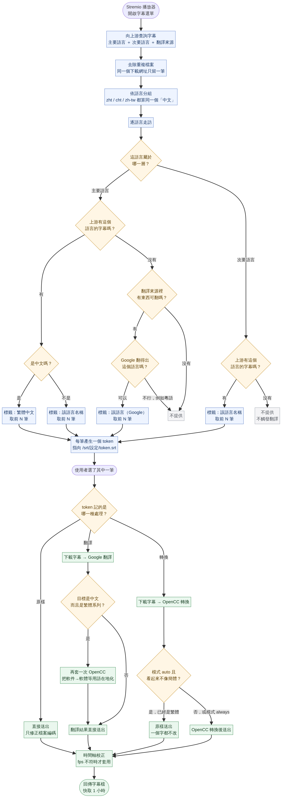

# 每一筆字幕的完整決策路徑



> 圖檔：`docs/subtitle-flow.png`；可編輯的原始檔：`docs/subtitle-flow.mmd`。
> 對應程式碼：`src/subtitles.js`（建立清單）與 `src/subtitle-file.js`（下載時處理）。

---

## 先回答：主要語言已經有字幕，還會觸發 OpenCC 嗎？

**會，但只有中文會，而且要看模式。**

| 情況 | 走哪條路 | OpenCC 會不會動它 |
| --- | --- | --- |
| 主要語言是**中文**，上游有中文字幕 | `convertSubtitle` | **會進轉換流程**。`auto` 模式下先判斷是否含簡體字：**已經是繁體的，一個字都不改**（`skipped`） |
| 主要語言是**中文**，上游沒有 | Google 翻譯 | 翻譯後若目標是繁體系列，**再套一次 OpenCC** 把用語在地化 |
| 主要語言是**其他語言**（例如 `en`），上游有 | `raw` 原樣 | **不會**。OpenCC 只處理中文，非中文連轉換函式都不會進去 |
| **次要語言**，上游有 | `raw` 原樣 | **不會**（同上） |

三點值得強調：

1. **「有直接來源」不等於「會被改動」。** 預設模式 `auto` 的判斷是
   「這份字幕看起來像簡體嗎」——已經是繁體的中文字幕會原樣送出，轉換函式只是被跳過，不是沒被呼叫。
2. **非中文完全不會碰到 OpenCC。** 中文字幕走轉換路徑，其他語言走 `raw` 路徑，兩者在建立 token 時就分開了，
   不是在下載時才判斷。
3. **只有翻譯出來的中文會無條件轉換。** 因為 Google 回傳的繁體不保證是你選的變體（台灣／香港用語不同），
   所以那裡用的是 `always` 模式，不看是否含簡體字。

---

## 兩張圖的分界：清單階段 vs 下載階段

流程圖上半是**建立清單**（開啟字幕選單時發生一次），下半是**下載**（你真正選了某一筆才發生）。
這個分界是刻意的：

- 清單階段只決定「要列出哪些筆」，**不做任何翻譯、不下載任何字幕檔**。
- 每一筆被壓成一個 token，token 記著「這個檔案要怎麼處理」。
- 翻譯是昂貴且慢的，所以它只在下載階段、而且只在你選了那一筆時才發生。

---

## 清單階段：三個分岔

對**每一種語言**分別走一次，不是整部片一起判斷。

```
這語言屬於哪一層？
├─ 主要語言 ──┬─ 上游有 ──┬─ 中文   → 標籤「繁體中文」，取前 N 筆
│             │           └─ 其他   → 標籤「English」等，取前 N 筆
│             └─ 上游沒有 ─┬─ 翻譯來源有東西 → 標籤「該語言（Google）」，取前 N 筆
│                          └─ 沒有           → 不提供
└─ 次要語言 ──┬─ 上游有   → 標籤「該語言名稱」，取前 N 筆
              └─ 上游沒有 → 不提供（不觸發翻譯）
```

**主要語言是承諾，次要語言是偏好。** 這是整個設計的核心差別。

三個容易誤解的細節：

- **「上游有」是分組後的結果。** `zht`、`cht`、`zh-tw` 在分組時就被視為同一個「中文」，
  所以任何一種拼法出現都算「有」。
- **「翻譯來源有東西」是相對的。** 要翻譯成 `af`（南非荷蘭語）時，翻譯來源裡若只有英文，
  就是拿英文去翻；若翻譯來源列出的語言上游一個都沒有，就沒東西可翻。
- **Google 翻不出的語言直接不提供。** 例如粵語（`yue`）沒有可用的目標代碼，
  與其給一個註定失敗的項目，不如不要出現。

---

## 下載階段：三種 token

| token | 什麼時候產生 | 處理方式 |
| --- | --- | --- |
| `r: 1` | 次要語言，或非中文的主要語言 | 只做編碼修正，內容原樣 |
| `x: 1` ＋ `g: 目標語言` | 主要語言缺字幕，翻譯補上 | 下載 → Google 翻譯 →（中文時）再套 OpenCC |
| 其他 | 中文的主要語言，上游有 | 下載 → OpenCC 轉換（`auto` 模式下可能跳過） |

三個分支之後**都會**經過時間軸校正，因為那是「字什麼時候出現」的問題，
跟「字說了什麼」無關——原樣送出的字幕一樣可能對不上。

---

## 具體例子

**例一：主要語言 `zh`，上游只有英文**

```
主要語言 zh → 上游沒有中文 → 翻譯來源有 eng
            → Google 翻不出中文嗎？翻得出 → 3 筆「繁體中文（Google）」
```

**例二：主要語言 `zh,en`，上游只有英文**

```
zh → 上游沒有 → 3 筆「繁體中文（Google）」
en → 上游有   → 3 筆「English」（原樣，不轉換）
```

中文那格被翻譯補上，英文照原樣列出。這就是「逐語言判斷」的效果。

**例三：主要語言 `zh`，上游已有中文字幕**

```
zh → 上游有 → 走 OpenCC 轉換路徑
            → auto 模式下判斷：這份字幕看起來像簡體嗎？
               ├─ 像   → 轉成繁體後送出
               └─ 不像 → 原樣送出，一個字都不改
```

**例四：次要語言 `ja`，上游沒有日文**

```
ja → 上游沒有 → 不提供。不會去翻譯，也不會出現在清單裡。
```

---

## 一覽表：什麼時候會發生什麼

| 階段 | 何時發生 | 是否呼叫外部服務 |
| --- | --- | --- |
| 向上游查詢字幕清單 | 每次開啟字幕選單 | 是（字幕來源） |
| 判斷語言、分組、排序 | 每次開啟字幕選單 | 否 |
| 產生 token | 每次開啟字幕選單 | 否 |
| 下載字幕檔 | 選了某一筆 | 是（字幕來源） |
| Google 翻譯 | 選了翻譯補上的那一筆 | 是（Google） |
| OpenCC 轉換 | 選了中文的那一筆 | 否（純本機運算） |
| 時間軸校正 | 任何一筆 | 否 |

**瀏覽字幕清單不會產生任何翻譯請求**，也不會下載任何字幕檔——這是刻意的，
因為一次字幕選單可能有數十筆候選，逐一翻譯既慢又浪費。
